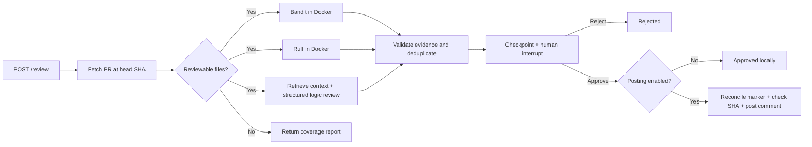

# Code Reviewer

A Python pull-request reviewer built with **LangGraph**, **LangChain's Google Gemini
integration**, FastAPI, and Docker-isolated Bandit/Ruff analysis. Reviews have
typed findings, explicit coverage, SQLite checkpoints, and human approval.

## Workflow



The three review branches run concurrently. Analyzers are deterministic graph
nodes, not model-selected commands. The logic branch uses Pydantic structured
output. Reducers combine branch findings and metrics before a single validation
step. There is no prose-to-JSON extraction and no model-controlled host path.

## Setup

Requirements: Python 3.12+, uv, Docker Engine/Desktop, and a Google AI Studio API key for
logic review. A GitHub token improves public repository rate limits and is
required for private repositories or posting comments.

```powershell
uv sync --locked --dev
Copy-Item .env.example .env
# Edit .env with your credentials; never commit it.
docker build -t code-review-tools:latest .
uv run code-reviewer
```

The API binds to `127.0.0.1:8000`. Interactive API documentation is at `/docs`.
Use **one worker** with the SQLite implementation. Requests are serialized by
the API lock; review branches run concurrently within each request. For larger
deployments, replace this with a job queue, PostgreSQL checkpointer, and a
distributed publication lock before adding workers.

Set `GOOGLE_API_KEY` in `.env` to your Google AI Studio API key. Reviews use the
Gemini Developer API through `langchain-google-genai`.
`STRONG_MODEL_NAME` selects the logic model (default: `gemini-3.8-flash`). It must
support Gemini's native structured output. When migrating an existing `.env`,
replace the old NVIDIA model name and add `GOOGLE_API_KEY`; NVIDIA keys cannot
authenticate Gemini calls. There is only one model role; no unmeasured
cheap-versus-strong model savings are claimed. Missing credentials or model
failures produce an explicit partial review rather than a clean result.

## API walkthrough

```powershell
$body = @{repo="owner/repository"; pr_number=1; logic=$true} | ConvertTo-Json
$review = Invoke-RestMethod http://127.0.0.1:8000/review -Method Post -ContentType application/json -Body $body
$review
Invoke-RestMethod "http://127.0.0.1:8000/reviews/$($review.review_id)"
```

Use `logic=false` for a static-analysis-only review without Gemini calls.
The response includes `review_id`, `head_sha`, `status`, `summary`, `findings`,
`coverage`, `errors`, `metrics`, and retrieved context references.

Each finding has a source (`bandit`, `ruff`, or `logic`), rule ID, severity,
1-based line, exact source-line evidence, explanation, fix, and
`in_changed_lines`. Findings elsewhere in changed files are retained and labeled.
Deduplication uses file, line, source, and rule ID; cross-analyzer findings are
kept so provenance is not lost.

The review pauses at `awaiting_approval`. You may stop and restart the server,
then resume using the same ID:

```powershell
Invoke-RestMethod "http://127.0.0.1:8000/reviews/$($review.review_id)/approval" -Method Post -ContentType application/json -Body '{"approved":true}'
```

With posting disabled, this returns `approved` without contacting GitHub to
write anything. `approved=false` returns `rejected`. Repeated approval requests
return HTTP 409. Empty reviews finish without an approval interrupt.

For failed fetch/publication steps, inspect the review and retry via
`POST /reviews/{review_id}/resume`. This resumes the checkpointed step, not the
entire review. Analyzer/model failures instead finish as partial reviews;
start a new review after fixing their cause.

## Optional GitHub publication

Set `ENABLE_GITHUB_POSTING=true`, `GITHUB_TOKEN`, and a long random `API_TOKEN`.
Send `Authorization: Bearer <API_TOKEN>` to every review endpoint. The app refuses
to start with posting enabled if either token is missing. Configure authentication
before exposing the API beyond localhost, even when posting is disabled.

Approval then posts **one PR conversation comment**, not inline review comments.
The publisher checks that the PR head still matches the reviewed SHA. A unique
marker and the authenticated GitHub user's ID reconcile a prior successful POST
whose response was lost. GET requests have bounded transient retries; POST is
never automatically retried by the HTTP adapter. This is duplicate prevention
for the documented single-worker deployment, not a claim of distributed
exactly-once delivery. A PR can still change immediately after the SHA check;
the comment records the reviewed commit.

## Retrieval and coverage

The logic branch performs bounded **lexical retrieval**, pinned to the same
head SHA. It ranks related test/module paths and project conventions, scans up
to 20 candidate files for changed symbols, and includes up to four excerpts
with source line references. This is a small retrieval baseline, not a vector
database or a complete call graph. Callers outside the candidate budget may
be missed. Retrieval errors and truncated trees are reported in coverage notes.

Defaults: 20 changed Python files, 100 KB per file, bounded source/prompt budget.
Deleted files, missing patches, unsafe paths, oversized content, and file-limit
skips are reported. GitHub's 3,000-file API limit is also surfaced. The fetcher
checks for a changed PR head before returning the snapshot.

## Isolation and data handling

- Credentials come from environment/configuration; `.env` and review data are ignored.
- Docker mounts only a temporary directory materialized from checkpointed source.
- Containers run as a non-root user, with no network, read-only root/mount,
  memory/CPU/PID limits, dropped capabilities, and a limited temporary filesystem.
- Timed-out analyzer containers are explicitly removed. PR code is never executed.
- Paths are checked for traversal, Windows reserved names, alternate streams,
  and case collisions. The LLM has no filesystem or shell tools.
- Repository text is untrusted input. Schema, location, evidence, and citation
  validation reduce bad output; they do not prove a model's reasoning is correct.

SQLite stores source snapshots, findings, and retrieved excerpts under
`.review-data/`. Protect this directory as repository data. It enables recovery
without relying on deleted temporary folders. Retention is manual: stop the
service and archive/remove the database only when those reviews are no longer
needed. No automatic retention or encryption at rest is implemented.

**If you used an earlier version with a credential in `src/agents.py`, rotate
that credential before using the service. Removing it from source cannot revoke it.**

## Offline demo

```powershell
uv run review-demo
```

This uses simulated GitHub, analyzer, and model results but a real graph and
SQLite database. It pauses a review, closes the database, creates a new graph,
and resumes with rejection. It never publishes anything. See
[`examples/demo-review.json`](examples/demo-review.json). To record a short
portfolio demo, show this command, the graph, and the artifact; label the
integrations as simulated. Use your own test PR for a separate live demo.

## Tests and evaluations

```powershell
uv run ruff check src tests
uv run pytest -q
uv build
uv run review-evaluate --output evaluation-results/baseline.json
# Optional paid model calls, after configuring a valid key:
uv run review-evaluate --with-logic --output evaluation-results/combined.json
```

Tests cover actual graph concurrency, restart recovery, approval rejection,
publication retries, stale SHAs, path confinement, malformed output, analyzer
failure, authentication, retrieval, and metric scoring. A local parser test
checks the static labels against installed Bandit/Ruff using only authored
fixtures. It never executes fixture code. Production and the evaluation CLI
always run analyzers through Docker.

The evaluation set contains 24 synthetic PR fixtures: six security issues, six
style issues, six logic bugs, and six clean cases. Reports compare the static
baseline with optional static-plus-logic review, tracking precision, recall,
false positives, latency, and provider-reported token usage. Matching is exact
on file, line, source, and rule; semantically equivalent findings on a different
line need manual review. Failed calls mark the evaluation invalid and cause a
nonzero CLI exit. These small seeded examples are not production accuracy
evidence. No model improvement or cost savings are claimed without a valid run.

CI runs lint, tests, an isolated wheel-import check, and the Docker baseline;
the evaluation report is uploaded as a build artifact. It needs no model secret.

## Optional LangSmith traces

Set these in the **process environment** before launching the API or evaluator:

```powershell
$env:LANGSMITH_TRACING="true"
$env:LANGSMITH_API_KEY="your-key"
$env:LANGSMITH_PROJECT="code-reviewer"
uv run code-reviewer
```

LangGraph/LangChain callbacks then trace node and model runs. Tracing is off by
default; enabling it sends source-containing inputs and outputs to LangSmith.
Token usage is also returned locally when the provider supplies it. Dollar cost
is not estimated because pricing depends on the chosen provider/account.

## Portfolio description

> Built a checkpointed LangGraph PR review workflow with parallel static analysis
> and structured LLM findings, repository-context retrieval, resumable human
> approval, Docker isolation, and a reproducible evaluation harness.

Attach measured evaluation results and a live demo before adding accuracy,
latency, or cost claims to a resume.
